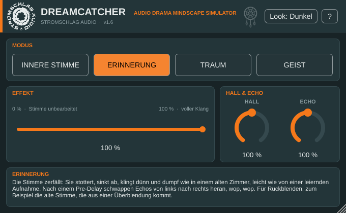
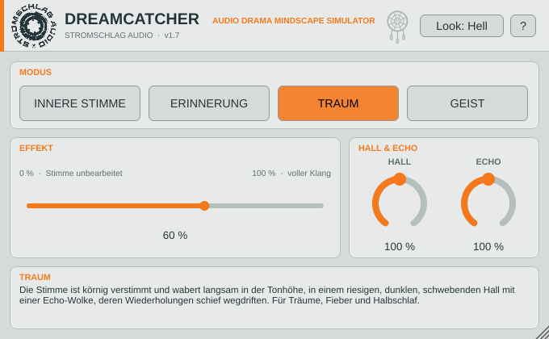

# DREAMCATCHER – Audio Drama Mindscape Simulator

<picture>
  <source media="(prefers-color-scheme: dark)" srcset="docs/logo-dunkel.png">
  
</picture>

VST3-Insert-Effekt für Hörspiel-Produktion. Er lässt eine Stimme klingen, als käme sie nicht aus dem Raum der Szene,
sondern von innen: als **innere Stimme**, als **Erinnerung / Rückblende**, im **Traum** oder als **Geist** mit echtem Reverse-Hall. Ein Modus-Schalter, ein
Fader und vier Drehregler für Hall, Echo, Breite und Ducking, fertig.

**⬇ Download (Windows · VST3 · Stereo):** https://github.com/StromschlagProductions/Dreamcatcher-vst/releases/latest

## Warum es dieses Plugin gibt

Gedanken, Rückblenden und Träume brauchen in fast jedem Hörspiel eine eigene Stimmbehandlung, damit man sofort
merkt: Das ist jetzt nicht die Szene, das ist im Kopf. Bisher habe ich das jedes Mal aus mehreren Effekten
zusammengebaut. DREAMCATCHER legt diese Behandlung mit einem Klick auf die Spur und lässt sich über die Zeit
ein- und ausblenden, zum Beispiel wenn eine alte Stimme aus einer Überblendung in der Rückblende auftaucht.

Der Klang jedes Modus ist fest abgestimmt; mit Hall, Echo, Breite und Ducking lässt er sich nachjustieren. Es gibt keinen Ausgangsregler, und es werden keine eigenen Geräusche
dazugemischt: Das Plugin verändert nur den Klang der Stimme.

*DREAMCATCHER soll niemandem die Erfahrung abnehmen, solche Szenen selbst zu gestalten. Gerade am Anfang kann es viel Spaß machen und lehrreich sein, eine Traum- oder Erinnerungsstimme selbst aufzubauen und zu hören, wie Verstimmung, Echo, Filter und Automation ineinandergreifen. Ich bin dankbar, dass ich diesen Weg selbst gegangen bin, auch wenn er manchmal umständlich und mühselig war. Gerade dadurch weiß ich, was ich mir von einem Werkzeug wünsche, das all das in einem vereint. DREAMCATCHER soll das Gestalten nicht ersetzen, sondern die technische Umsetzung im Alltag einfacher machen.*

– Lars Eickstädt, Stromschlag Audio

## Oberfläche

| Erinnerung (dunkel) | Traum, Effekt 60 % (hell) |
|---|---|
|  |  |

Oben wählt man den Modus, darunter stehen der **Effekt-Fader** und die Drehregler **Hall**, **Echo**, **Breite** und **Ducking**. Der **?**-Knopf öffnet die Hilfe, Look Dunkel/Hell und
die Fenstergröße (50–300 %) werden mit dem Projekt gespeichert. Zu jedem Regler gibt es einen Tooltip.

## Modi und Regler (beide automatisierbar)

| Regler | Wirkung |
|---|---|
| **Modus** | **Innere Stimme:** Die Stimme rückt ins Innere des Kopfes: schmal, nah, ein winziger, enger Raum und ein Hauch Echo, Höhen weicher, Tiefen weg. **Erinnerung:** Die Stimme stottert, sinkt ab, klingt dünn und dumpf in einem kleinen, alten Zimmer, leicht wie von einer leiernden Aufnahme; nach einem Pre-Delay schwappen Ping-Pong-Echos von links nach rechts heran und schwellen an (wop, wop), für Rückblenden. **Traum:** körnig verstimmt, die Tonhöhe wabert langsam, in einem riesigen, dunklen, schwebenden Hall mit einer Echo-Wolke, deren Wiederholungen schief wegdriften. **Geist:** echter Reverse-Hall, vor jedem Wort schwillt ein Geisterhall an und rückwärts gespielte Stücke saugen ins Wort hinein, dann kommt die Stimme, trocken und ohne Nachhall (meldet rund 0,6 s Latenz). Beim Wechsel blendet das Plugin in etwa einer zehntel Sekunde über. |
| **Effekt** | 0 % = die Stimme unbearbeitet, 100 % = der volle Klang des Modus, dazwischen fließend (Standard: 100 %). Doppelklick setzt auf 100 % zurück. |
| **Ducking** | Drehregler 0–100 %, Grundeinstellung 0 % (aus): Die Originalstimme drückt die Effektanteile (Echos, Echo-Wolke, Hall; im Modus Geist Reverse-Hall und Reverse-Echo) herunter, solange sie spricht, und sie kehren nach etwa einer Viertelsekunde zurück, wenn die Stimme aufhört. 100 % senkt die Effekte bei voller Stimme um etwa 24 dB ab. Stimme, Stottern, Wabern und Breite bleiben unberührt. Im Modus Geist reagiert der Detektor auf die verzögerte Stimme. So kannst du Hall und Echo höher drehen, ohne dass die Stimme untergeht. |
| **Breite** | Drehregler 0–200 %: 0 % = mono, 100 % = so breit, wie der Modus abgestimmt ist, 200 % = deutlich breiter; über 100 % wird das Seitensignal zusätzlich minimal verzögert (Prinzip von Airwindows Wider), dann wirkt es breiter als die Lautsprecher. Monokompatibel: Der Regler verändert nur das Seitensignal, in Mono klingt es bei jeder Einstellung exakt gleich. |
| **Hall** / **Echo** | Drehregler 0–200 %: 100 % = so, wie der Modus abgestimmt ist, 0 % = aus, 200 % = doppelt so viel. Im Modus Geist heißen sie **Reverse-Hall** und **Reverse-Echo**: so wählst du nur den rückwärts anschwellenden Hall, nur die rückwärts gespielten Echos oder beides. Doppelklick setzt auf 100 % zurück. |

Das ist wie bei LOCATIONS: Ein Fader bewegt die Stimme zwischen zwei Zuständen. Hier sind es die normal klingende
Stimme und der Traum. Einen extra Ein-/Ausschalter gibt es nicht, 0 % ist aus.

## Anwendung

- **Rückblende (Beispiel KADAITCHA):** Spur der alten Stimme auf Erinnerung, Effekt in der Überblendung per Automation von
  0 auf 100 % fahren. Die Stimme wächst aus dem Hier und Jetzt in die Erinnerung hinein.
- **Aufwachen:** Spur auf Traum, Effekt vom Ende der Traumszene an auf 0 % zurückfahren: Die Stimme wird direkter und klarer.
- **Innere Stimme:** Spur auf Innere Stimme, Effekt auf 100 %. Zum Zurückholen ins Gespräch auf 0 % fahren.
- **Auf einem Bus:** DREAMCATCHER lässt sich auch auf einen Gruppenkanal legen. So bekommen die Stimme und die Geräusche
  einer Traum- oder Erinnerungsszene (Atmo, Schritte, Musik) gemeinsam dieselbe Behandlung und wirken wie aus einer
  Welt. Der Effekt arbeitet dann auf der Summe, jede Quelle behält ihren Platz im Stereobild. Ein Fader auf dem Bus
  blendet die ganze Szene zusammen in den Effekt hinein oder zurück ins Hier und Jetzt.
- **Ein Fehler beim Abmischen:** Effekt kurz auf 0 % ziehen, die Stimme ist sofort wieder unbearbeitet.

## Hinweise

- **Latenz:** Nur im Modus **Geist** meldet das Plugin rund 0,6 s Latenz an den Host, damit der Reverse-Hall vor der Stimme
  liegen kann; die DAW gleicht das aus. Die anderen drei Modi sind latenzfrei. Weil sich die gemeldete Latenz beim
  Moduswechsel ändert, verwendest du Geist am besten auf einer eigenen Spur oder Plugin-Instanz und automatisierst den Modus
  nicht quer durch die Szene. Hall und Echos klingen nach dem Ende der Stimme nach, im Modus Traum bis zu etwa fünf Sekunden; im Modus Geist bleibt die Stimme trocken, es gibt keinen Nachhall.
  Zwischen 0 und 100 % mischen sich bearbeitete und unbearbeitete Stimme, dabei können leichte Kammfilter-Färbungen entstehen.
- Der Eingang wird als Stereo verarbeitet; eine Mono-Spur bekommt durch die Echo-Bausteine Stereobreite.
- Der Pegel ist fest ausgeglichen: bei 100 % ist die Stimme etwa so laut wie bei 0 % (gemessen mit einem
  Testsignal, bei echten Stimmen kann es um ein paar dB abweichen).
- Nach dem Ende der Stimme klingt die Echo-Wolke noch kurz nach.

## Installation (Windows)

1. Über den Download-Link oben `Dreamcatcher-VST3-Windows.zip` laden.
2. ZIP entpacken und den **ganzen Ordner** `Dreamcatcher.vst3` nach `C:\Program Files\Common Files\VST3` kopieren.
3. DAW neu starten bzw. Plugins neu scannen.

## Versionen

Die Versionsnummer steht in der Datei `VERSION`, im Plugin-Kopf und im Namen der Release. Sie wird bei jeder
Änderung hochgezählt.

- **2.2** – Echtzeitsicherer Reset ohne neue Pufferreservierungen, Latenzmeldung ohne OS-Nachricht aus dem Audio-Thread, begrenzte Ringzähler und neue Regressionstests. [Details](docs/RELEASE_NOTES.md).
- **2.1** – Traum: Das Knacken und das leise, körnige „8-Bit“-Rauschen im Nachklang sind weg. Ursache war nicht das Ducking, sondern die harte Verstimmung (PitchNasty); sie ist durch eine weiche, überblendete Verstimmung ersetzt. Pegel neu abgeglichen.
- **2.0** – Vierter Drehregler **Ducking** (0–100 %, Grundeinstellung aus): Die Stimme drückt Echos, Hall und Reverse herunter, solange sie spricht; Stimme und Breite bleiben unberührt.
- **1.9** – Hilfe und README korrigiert: Der Breite-Regler ist monokompatibel (in Mono bei jeder Einstellung exakt gleich).
- **1.8** – Dritter Drehregler **Breite** (Stereobreite 0–200 %, über 100 % breiter als die Lautsprecher nach dem Prinzip von Airwindows Wider).
- **1.7** – Erinnerung mit stärkerem Bandleiern; Traum mit stärkerem Wabern, breiter und mit größerem, stärker schwebendem Hall. Pegelausgleich jetzt nach gehörrichtiger Lautheit (LU) an einem stimmähnlichen Signal gemessen.
- **1.6** – Erinnerung und Traum deutlich zurückgenommen (Echos, Hall, Echo-Wolke, Stottern und Verstimmung etwa halbiert, Pegel neu abgeglichen), damit die Stimme verständlich bleibt. Geist: der Vorwärts-Hall hinter der Stimme ist wieder weg, die Stimme bleibt trocken. Erinnerung mit leichtem Bandleiern (Airwindows Flutter), Traum mit langsam wabernder Tonhöhe (Airwindows GalacticVibe) und Echos, die schief wegdriften, damit sich Traum deutlicher von Erinnerung abhebt.
- **1.5** – Drehregler Hall und Echo (0–200 %, 100 % = Preset); im Modus Geist zusätzlich Reverse-Echo, die Regler heißen dort Reverse-Hall und Reverse-Echo. Neuer Untertitel „Audio Drama Mindscape Simulator“, mehr Luft um das Traumfänger-Symbol.
- **1.4** – Echter Hall in allen Modi (nach Airwindows Galactic), je Modus ein eigener Raum: winzig (Innere Stimme), kleines dumpfes Zimmer (Erinnerung), riesige dunkle Halle (Traum), Nachhall hinter der Stimme (Geist). Pegel neu abgeglichen.
- **1.3** – Modi deutlich stärker unterschieden; neues Schwapp-Echo mit Pre-Delay (Ping-Pong, abfallend oder anschwellend) in Erinnerung und Traum; vierter Modus Geist mit echtem Reverse-Hall (Latenz nur in diesem Modus).
- **1.2** – Hinweis zur Nutzung auf einem Bus in README und Plugin-Hilfe ergänzt.
- **1.1** – README um den Absatz „Gestalten nicht ersetzen“ ergänzt.
- **1.0** – Erste Version: Modi Innere Stimme, Erinnerung und Traum, Effekt-Fader 0–100 %, Oberfläche im Stil von
  LOCATIONS und RADIOPHONE mit Hilfe, Hell/Dunkel und skalierbarem Fenster.

## Aufbau

- `Source/DreamcatcherDSP.h`: Klang-Engine (reines C++). Die Klangwerte der drei Modi stehen oben in `kVoicing`.
- `Source/PluginProcessor.*`, `Source/PluginEditor.*`: JUCE-Plugin und Oberfläche
- `LICENSES/`: Lizenztext der übernommenen Airwindows-Bausteine
- `.github/workflows/build.yml`: Windows-Bau mit Stabilitätstest (pluginval), nur auf Anforderung gestartet; ein Release entsteht nur, wenn beim Start „release“ angehakt wird (siehe `.github/CI.md`)

## Beta-Test und Danke

**SOUNDJOB / Markus Hildebrandt** – Beta-Testing

Gebaut mit [JUCE](https://juce.com) 8. Die Klangbausteine **SweetWide**, **StereoEnsemble**, **GlitchShifter**,
**Flutter**, **GalacticVibe** und der Hall **Galactic** sind Portierungen von Airwindows-Code von Chris Johnson
([github.com/airwindows](https://github.com/airwindows/airwindows), MIT-Lizenz). Angepasst wurden nur die Struktur
(freie Abtastrate) und die Dither-Stufe, die weggelassen ist; die Algorithmen selbst sind übernommen.

---

## Hinweis / Disclaimer

**Open Source · Work in Progress**

Dieses Plugin wurde in erster Linie für meinen persönlichen Workflow bei der Hörspielproduktion entwickelt. Es ist auf meine eigenen Anforderungen zugeschnitten und muss daher nicht für jeden Anwendungsfall geeignet sein.

Das Projekt wird laufend weiterentwickelt. Trotz sorgfältiger Tests können Fehler oder Kompatibilitätsprobleme auftreten. Die Software wird ohne Gewährleistung bereitgestellt; die Nutzung erfolgt auf eigene Verantwortung. Eine Haftung für mögliche Schäden oder Datenverluste wird, soweit gesetzlich zulässig, ausgeschlossen. Es gelten die jeweiligen Lizenzbedingungen.

**Feedback, Fehlermeldungen und Verbesserungsvorschläge sind herzlich willkommen!**

Wenn dieses kleine Werkzeug auch anderen die Hörspielarbeit erleichtert und mehr Raum für Geschichten und menschliche Kreativität schafft, freut mich das ganz besonders.
